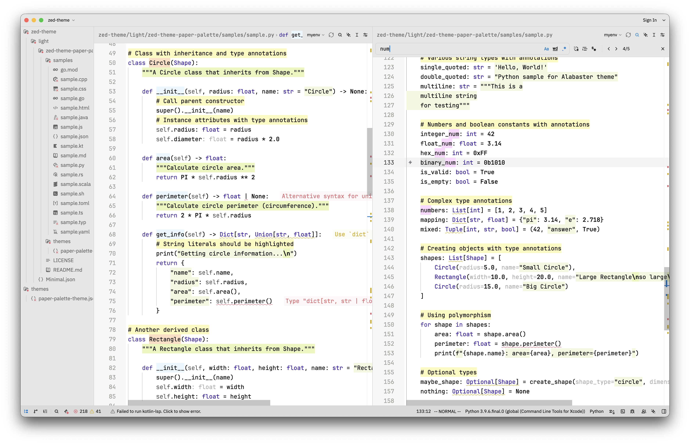

# Paper Palette — Zed Theme

## Phylosophy

> Highlight only the valuable

## Color Scheme

### Pens & Highlighters

Theme "Pens & Highlighters" brings us to the school time when only pens and
highlighters were avalable for text coloring. And that was enough to create
lecture notes which carefully pay attention to only things that really matters.
So, theme's color scheme has only 3 font colors which are corresponding to black
and blue pen and gray pencil and several highlighter common colors. 

Background colors are good for cursory reading when you need to understand the
structure of your text and pay attention to important, "highlighted" things.
Bold black font represents important thing in close reading while thin font or
gray color are responding for additional information. Blue color is representing
significant but side information rather than main ideas.

Preview:

### Pens & Highlighters Dark

The dark adaptation keeps the same principle: highlight only the valuable.
Emphasis follows contextual meaning, not just syntax category: recurring language
vocabulary should recede, while names and values specific to the program stand out.

- Light gray (`#a3a49f`) for built-in constants, booleans, special variables such
  as `self`, operators, punctuation, and preprocessor syntax.
- Soft white/ivory (`#e3e0d7`) for keywords, variables, parameters, function
  references, attributes, and other ordinary names, as well as numbers and named
  constants. Keywords remain regular-weight but visible on charcoal.
- Higher-contrast pale blue-violet (`#c3cff7`) for constructors, enums, and variants.
- Desaturated pale blue-violet (`#b1b8ce`) for type names (including built-ins),
  member/property references, namespaces, and links.
- Brighter pale blue-violet (`#c3cff7`) for member functions and method/function
  declarations. These remain background-free so their names stand out without
  turning the whole declaration into a highlighted block.
- Inline hints stay pencil gray (`#9a9c98`), separate from explicit type names.

These distinctions depend on the syntax captures provided by each language;
a theme cannot infer whether every identifier is built-in or user-defined.
Background highlights remain muted washes rather than bright pastel blocks:

- Warning-yellow text (`#d3bc7c`) on ochre for comments and documentation comments.
- Green text (`#a5bf92`) on moss green for strings, with a stronger background
  wash for special string forms.
- Slate blue for type/class declarations; methods have no syntax background.
- Slate blue also remains available for namespaces and titles; muted peach marks
  constructors and labels.
- Neutral gray for embedded content and inline code; mauve for search matches.

Numbers and named constants keep their semibold emphasis; booleans and built-in
constants use regular-weight gray so fixed vocabulary does not compete with
context-specific content. Completion suggestions use pencil gray to distinguish
them from accepted code. Charcoal panels, subdued guides, and a neutral selection keep
the interface quiet; terminal and diagnostic colors are adapted as well.

To install, copy `themes/paper-palette-dark-theme.json` into `~/.config/zed/themes/`,
then choose **Pens & Highlighters Dark** using `theme selector: toggle` in Zed's
command palette. The light theme is unchanged.

## Heritage

Theme is based on [Alabaster][alabaster] theme for Zed which is based on the [same name theme for sublime][alabaster-tonsky]

[alabaster]: https://github.com/tsimoshka/zed-theme-alabaster
[alabaster-tonsky]: https://github.com/tonsky/sublime-scheme-alabaster
